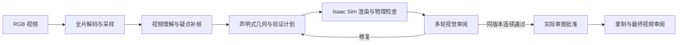

# Real2Sim Pipeline

将完整 RGB 视频整理为 **有来源证据、可检查、经过多轮审阅的 Isaac Sim 场景与独立资产**。
模型通过官方 OpenAI Responses API 理解视频、规划几何、审阅结果；固定编译器负责 USD、碰撞和关节生成。

> 本项目重建场景及关键状态。检查视频通过设置关键状态和移动相机生成，不代表连续动作恢复或机器人策略成功。人体/手部只用于理解，不作为资产重建。

## 工作流



导师可从 [审阅入口](docs/mentor-guide.zh.md) 开始。

输入：视频、模型配置、GPU 主机上的 Isaac Sim Python 路径。输出：物体与动作理解、版本化场景 JSON、USD 和独立资产、源/仿真图片、物理报告、审阅记录、场景检查视频。

## 安装与快速检查

控制端要求 Python 3.11+、Linux。Isaac Sim 使用独立 Python 环境；不要把 OpenAI SDK 安装进 Kit 的环境。

```bash
python3.12 -m venv .venv
source .venv/bin/activate
python -m pip install -e '.[dev]'
cp config.example.toml config.toml
# 在 config.toml 中设置可用模型和 Isaac Python 路径。
# 真实调用前在本机设置 OPENAI_API_KEY；当前按要求留空。
real2sim doctor
real2sim validate examples/box-proposal.json
pytest
```

`doctor` 不调用模型，不产生 API 费用。模型名必须是你的 API 项目有权限使用且支持视觉和结构化输出的型号。ChatGPT 登录不会被本项目读取，也不等于 API 凭据。

## 运行自己的视频

完整运行在有 NVIDIA GPU 和 Isaac Sim 的 Linux 主机上执行；也可以先在 CPU 主机准备采样，再把项目和输入复制到 GPU 主机。

```bash
real2sim prepare /data/example.mp4 --scene example --output runs/example
real2sim run /data/example.mp4 --scene example --output runs/example
real2sim status runs/example
```

检查 `runs/example/source/` 的时间线、当前版本的 `render/review-*.jpg` 和 `physics/`，确认完整任务、隐藏物体、几何和物理证据后记录实际审图结论：

```bash
real2sim approve runs/example --reviewer 'reviewer-name' \
  --observations '填写实际检查的状态、物体、几何差异及接受理由，不能复制这句占位文字。'
real2sim record runs/example
```

默认同一版本需要连续两次模型审阅通过，然后由实际审图者批准；最终视频还要完整解码并再次接受模型审阅。批准文件绑定输入与输出哈希，修改场景后旧批准失效。

## 可靠性与范围

- 所有模型输出遵守严格结构，并进行对象引用、状态、关节范围和证据边界检查。
- 隐藏物体依据后续显露证据追溯初始位置；无法观察的部分保留不确定性。
- 补帧允许多轮；达到上限仍有缺失证据时停止，不能自动写“通过”。
- 渲染和物理测试在独立进程运行；模型不能生成待执行的 Python/shell。
- HTTP 请求、配置、图像和输出均有证据记录。网络超时不会自动重发可能已计费的调用。
- 几何使用参数化组合体；没有声称从 RGB 精确恢复尺寸、质量、摩擦或纸板柔性。
- 物理路径包括静置、驱动关节扫掠、装配保持/独立释放、杯盖接触与表面查询、球体/支撑面自由落体，以及六角工具接口诊断。每类探针有明确的几何与运动限制，超出能力时停止。

详见 [架构与审阅协议](docs/architecture.zh.md)、[验证记录](docs/validation.zh.md) 和 [迁移说明](docs/migration.zh.md) 和 [操作与故障恢复](docs/operator-guide.zh.md)。

## 项目目录

```text
src/video_real2sim/
  config.py       配置与预算
  models.py       严格数据契约
  provider.py     OpenAI Responses 调用与证据记录
  video.py        全片采样、补帧、视频检查
  pipeline.py     可恢复的多轮状态机
  backend.py      原生进程与物理证据校验
  native/         固定的 Isaac 编译器与物理工作器
  prompts/        可阅读、可版本化的阶段提示
tests/            API 协议、状态机、数据与失败路径测试
examples/         不含视频和凭据的可检查示例
```

API 请求会发送所选图片和任务文本到配置的服务端。共享仓库仅包含代码和无凭据示例；真实视频与运行目录默认排除。数据集视频的使用和转发需遵循其原始授权。项目尚未选择对外开源许可证，当前供研究协作审阅。

`checks/native-box-orbit.mp4` 是合成盒子样例的原生录制，用于验证安装与渲染链路；它不是输入视频重建效果或机器人任务演示。
